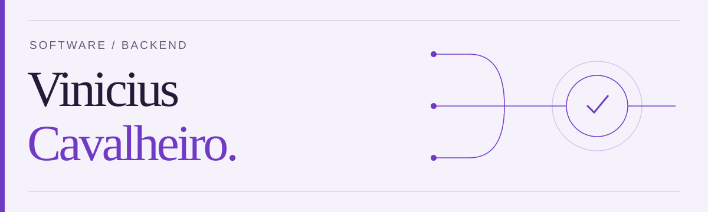

### Backend Developer | Java, Spring Boot, SQL & REST APIs

Computer Science student at Cruzeiro do Sul Virtual (expected graduation: June 2028). Looking for backend or software engineering internships and junior roles.

**English:** C1 Advanced (EF SET 66/100) · **Location:** São Paulo, Brazil (remote across Brazil or hybrid/on-site in SP tech hubs — Campinas, São Paulo, Ribeirão Preto, São Carlos, SJC).

[Portfolio](https://vinioccode.github.io/portfolio/) · [LinkedIn](https://www.linkedin.com/in/viniciusoccavalheiro/)

### Experience

- **Mercado Livre Automation Dashboard (Freelance, 2026):** independently designed and built a production dashboard for listing creation, publication, editing, and catalog auditing via Mercado Livre API and OAuth2 (500+ listings processed). [Public case study](https://vinioccode.github.io/mlbot-case-study/)
- **Infrastructure Automation Tool (Freelance, 2023–2024):** Python desktop application to provision and configure DigitalOcean instances via API and SSH, packaged for Windows with PyInstaller.

### Selected projects

- **[Diet Calc](https://github.com/ViniOcCode/diet-calc):** Python/Flask web app for nutrition estimates with server-side validation, Pytest suite, and CI. [Live demo](https://diet-calc.onrender.com/)
- **[Note Taking C](https://github.com/ViniOcCode/note-taking-c):** POSIX command-line Markdown note manager in C (Harvard CS50x 2025 final project) with Meson build, Docker, and end-to-end tests.
- **[Production Control 1.0](https://github.com/ViniOcCode/Controle-de-Producao-1.0):** C#, WinForms, and SQLite desktop app for inventory, raw materials, and daily production metrics.

### Stack

**Primary focus:** Java, Spring Boot, PostgreSQL, Docker, REST APIs, SQL, Automated Testing, Git.  
**Prior production & academic work:** Python (Flask/FastAPI), TypeScript/JavaScript, C#, C, OAuth2, SQLite.

Contact: [LinkedIn](https://www.linkedin.com/in/viniciusoccavalheiro/)

Em português

### Desenvolvedor Backend | Java, Spring Boot, SQL e APIs REST

Estudante de Ciência da Computação na Cruzeiro do Sul Virtual (conclusão prevista: junho de 2028). Busco estágio ou vaga júnior em desenvolvimento backend ou software.

**Inglês:** C1 Avançado (EF SET 66/100) · **Localização:** São Paulo, Brasil (remoto no Brasil ou híbrido/presencial em polos de SP — Campinas, São Paulo, Ribeirão Preto, São Carlos, SJC).

[Portfólio](https://vinioccode.github.io/portfolio/) · [LinkedIn](https://www.linkedin.com/in/viniciusoccavalheiro/)

### Experiência

- **Painel de Automação Mercado Livre (Freelance, 2026):** arquitetura e implementação ponta a ponta de um painel em produção para criação, publicação, edição e auditoria de anúncios via API do Mercado Livre e OAuth2 (500+ anúncios processados). [Estudo de caso público](https://vinioccode.github.io/mlbot-case-study/)
- **Automação de Infraestrutura (Freelance, 2023–2024):** aplicação desktop em Python para gerenciar instâncias na DigitalOcean via API e automatizar setup por SSH, empacotada para Windows com PyInstaller.

### Projetos selecionados

- **[Diet Calc](https://github.com/ViniOcCode/diet-calc):** aplicação web em Python/Flask com validação de entradas, testes com Pytest e CI. [Demo](https://diet-calc.onrender.com/)
- **[Note Taking C](https://github.com/ViniOcCode/note-taking-c):** CLI em C para notas Markdown (projeto final do Harvard CS50x 2025), com build Meson, Docker e testes ponta a ponta.
- **[Controle de Produção 1.0](https://github.com/ViniOcCode/Controle-de-Producao-1.0):** aplicação desktop em C#, WinForms e SQLite para produtos, matérias-primas e indicadores diários.

### Stack

**Foco principal:** Java, Spring Boot, PostgreSQL, Docker, APIs REST, SQL, Testes Automatizados, Git.  
**Experiência prévia (freelas e faculdade):** Python (Flask/FastAPI), TypeScript/JavaScript, C#, C, OAuth2, SQLite.

Contato: [LinkedIn](https://www.linkedin.com/in/viniciusoccavalheiro/)

